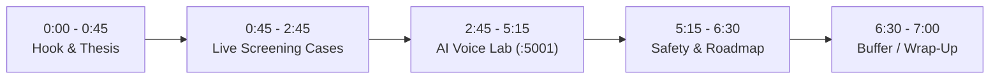

# KinGuard: 7-Minute Demo & Testing Master Plan

This plan is optimized for a **tight, professional 7-minute presentation** showing the side-by-side Android Emulator, the **KinGuard** Caregiver Dashboard (`:5173`), and the browser-based **KinGuard AI Voice Lab Console (`:5001`)**—with **zero terminal windows needed on screen**.

---

## 1. Pre-Flight Setup Checklist (Before Hitting Record)

| Item | Step | Verified? |
| :--- | :--- | :---: |
| **1. Start Python Server** | In `python-backend/`, ensure `GROQ_API_KEY` is in `.env` and run `.\venv\Scripts\python app.py` (serves API + Web Console at `http://localhost:5001`). | [ ] |
| **2. Start Dashboard** | In `react-dashboard/`, run `npm run dev` (serves Caregiver Dashboard at `http://localhost:5173`). | [ ] |
| **3. Upload/Verify Audio** | Open `http://localhost:5001` in a browser tab. Verify the `/samples` dropdown has the generated `.wav` files or upload your YouTube scam `.mp3` directly on that page. | [ ] |
| **4. Emulator Setup** | Open Android Studio, run **KinGuard** on the emulator, and float the emulator window to the right third of your screen. | [ ] |
| **5. Screening Role** | On the emulator, ensure the green box says **"KinGuard Active (Zero-UI Mode)"**. | [ ] |
| **6. Contacts Clean** | In the emulator Contacts app, ensure your test contact does **not** end in `8888`, `9999`, or `7777`. | [ ] |
| **7. Reset Baseline** | Click **"Reset"** in the top-right of the KinGuard dashboard to start with the clean baseline. | [ ] |

---

## 2. Screen Layout Staging (No Terminal Required!)

Arrange your desktop into a clean two-window layout:

```
+---------------------------------------------------+-----------------------+
|  LEFT (65% Width): Browser Window                 | RIGHT (35% Width):    |
|  - Tab 1: KinGuard Caregiver Dashboard (:5173)    | Android Emulator      |
|  - Tab 2: KinGuard AI Voice Lab (:5001)           | (Mom's Galaxy S24)    |
|    (Or click "AI Voice Lab (:5001)" in header)    | Screen stays dark /   |
|                                                   | ringer silenced       |
+---------------------------------------------------+-----------------------+
```

---

## 3. Minute-by-Minute Demo Script (7:00 Max)



### [0:00 – 0:45] Act I: The Problem & The "Zero-UI" Thesis
* **Spoken Pitch:**
  > *"Every year, vulnerable seniors lose over \$3 billion to phone scams. Traditional call blockers fail because they show alarming warning banners, or rely on static blacklists that scammers easily bypass using spoofed caller IDs. Worse, popups cause anxiety or provoke 'curious callbacks.'*
  > 
  > *This is **KinGuard**: an AI-driven, Zero-UI call protection system. On the senior's phone, it is completely invisible. No scary popups, no modified dialers, and zero panic. Instead, all triage is delegated off-device to a trusted family caregiver."*

---

### [0:45 – 2:45] Act II: Live End-to-End Scenarios (Emulator + Dashboard)

#### Case 1: The Instant Auto-Drop (>90% Scam Risk) — [0:45 – 1:25]
* **Action:** Click **"Simulate Auto-Block (>90%)"** (dials `+1 888-555-9999`).
* **Visual on Emulator:** Point to the phone screen—**nothing happens**. The screen stays dark, the ringer stays completely silent, and the call is scrubbed from the native call log.
* **Visual on Dashboard:** The **"Scams Blocked"** counter ticks up, and the **Blocked Call Log** drawer records the forensic event.

#### Case 2: Ambiguous Threat $\rightarrow$ Caregiver Triage $\rightarrow$ Redial Test — [1:25 – 2:15]
* **Action 1:** Click **"Simulate Suspicious Call (88%)"** (dials `+1 800-582-8888`).
* **Visual:** The phone is silenced. The card immediately appears on the website under **"Calls Waiting for Your Review"**.
* **Action 2:** Click **"Allow Caller"** on the dashboard.
* **Action 3:** Click **"Simulate Suspicious Call (88%)"** a second time.
* **Visual on Emulator:** The phone **now rings out loud!**

#### Case 3: The 5-Minute Emergency Repeat-Caller Bypass — [2:15 – 2:45]
* **Action:** Dial an unknown number twice in a row within 5 minutes.
* **Spoken:**
  > *"What if an unknown number calls from an emergency room? KinGuard enforces a strict 5-minute sliding window: if an unsaved number redials immediately, the life-safety bypass kicks in and rings the phone. Family emergencies are never locked out."*

---

### [2:45 – 5:15] Act III: Live Audio Transcription & Scam Detection (`http://localhost:5001`)
*(Click the dark **"AI Voice Lab (:5001)"** button in the top-right of the KinGuard dashboard to switch to the Python Server Web Console)*

1. **Select & Play Scam Audio:**
   * Choose your YouTube scam clip (or `irs_scam_call.wav`) from the **`/samples` dropdown**.
   * Leave **"Play audio when analyzing"** checked so the judges hear the scammer speaking.
2. **Click "Transcribe & Evaluate Call Audio":**
   * **Step 1 (Groq Whisper `whisper-large-v3-turbo`):** Point to the live transcription latency badge (`~300ms`) and the verbatim spoken transcript box that appears on the right.
   * **Step 2 (Groq LLM `openai/gpt-oss-20b`):** Point to the **Scam Confidence Score (`97%`)**, the **`AUTO-BLOCK & SEVER CALL`** verdict banner, the AI reasoning, and the detected tactic tags (`Authority Impersonation`, `Urgency / Arrest Threat`, `Payment Demand`).
   * **Step 3 (Live Server Log at Bottom):** Point to the dark **Live Backend Server Log (`:5001`)** panel at the bottom of the webpage, showing all real-time `METADATA`, `VOICE_AI`, and `RESOLVE` evaluations handled by Flask.
3. **Switch Back to Caregiver Dashboard Tab (`:5173`):**
   * Show the judges that the exact YouTube transcript, Groq AI reasoning, and Risk Score Ring have **automatically synced** onto the main Caregiver Dashboard!

---

### [5:15 – 6:30] Act IV: Fail-Closed Safety, Architecture & Future Roadmap
* **Spoken Script:**
  > *"KinGuard is built on three core engineering pillars:
  > 1. **Fail-Closed Safety:** Mom's local address book always rings with 0ms delay—even if our server or internet goes down completely.
  > 2. **24-Hour TTL Caches:** Numbers blocked by the caregiver are cached on-device to prevent repetitive network spam without permanently blacklisting spoofed legitimate numbers.
  > 3. **Dual-Layer Defense:** Combining fast pre-ring metadata screening with real-time Whisper + LLM transcript analysis."*

---

### [6:30 – 7:00] Act V: Closing & Wrap-Up
* **Spoken Closing:**
  > *"KinGuard replaces anxiety with quiet confidence. It protects our parents and grandparents from aggressive phone fraud without burdening them with a single popup. Thank you."*
