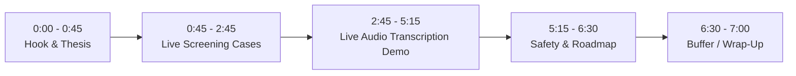

# KinGuard: 7-Minute Demo & Testing Master Plan

This plan is optimized for a **tight, professional 7-minute presentation** showing the side-by-side Android Emulator, the **KinGuard** Caregiver Dashboard, and the Python AI Voice & Transcript Engine (`audio_demo.py` + `app.py`).

---

## 1. Pre-Flight Setup Checklist (Before Hitting Record)

| Item | Step | Verified? |
| :--- | :--- | :---: |
| **1. Add Scam Audio** | Drop your YouTube scam `.mp3` or `.wav` clip into `python-backend/samples/` (or run `.\generate_samples.ps1` inside `python-backend/` to generate 3 `.wav` files). | [ ] |
| **2. Python Backend** | In Terminal 1 (`python-backend/`), ensure `GROQ_API_KEY` is in `.env` and run `.\venv\Scripts\python app.py` (listens on `:5001`). | [ ] |
| **3. Dashboard + Bridge** | In Terminal 2 (`react-dashboard/`), run `npm run dev` (opens `http://localhost:5173` and bridges to `:5001` + ADB). | [ ] |
| **4. Emulator Setup** | Open Android Studio, run **KinGuard** on the emulator, and float the emulator window to the right half of your screen. | [ ] |
| **5. Screening Role** | On the emulator, ensure the green box says **"KinGuard Active (Zero-UI Mode)"**. | [ ] |
| **6. Contacts Clean** | In the emulator Contacts app, ensure your test contact does **not** end in `8888`, `9999`, or `7777`. | [ ] |
| **7. Reset Baseline** | Click **"Reset"** in the top-right of the KinGuard dashboard to start with the clean baseline. | [ ] |

---

## 2. Screen Layout Staging

Arrange your desktop into a side-by-side layout:

```
+------------------------------------------+-----------------------+
|  LEFT (65% Width): KinGuard Dashboard    | RIGHT (35% Width):   |
|  - Real-time review queue & transcripts  | Android Emulator      |
|  - Blocked call log & Allowed contacts   | (Mom's Galaxy S24)    |
|  - Simulator triggers at the top         | Screen stays dark /   |
|                                          | ringer silenced       |
+------------------------------------------+-----------------------+
|  BOTTOM / OVERLAY: Terminal for python app.py & audio_demo.py    |
+------------------------------------------------------------------+
```

---

## 3. Minute-by-Minute Demo Script (7:00 Max)



### [0:00 – 0:45] Act I: The Problem & The "Zero-UI" Thesis
* **Spoken Pitch:**
  > *"Every year, vulnerable seniors lose over \$3 billion to phone scams. Traditional call blockers fail because they show alarming warning banners, or rely on static blacklists that scammers easily bypass using spoofed caller IDs. Worse, popups cause anxiety or provoke 'curious callbacks.'*
  > 
  > *This is **KinGuard**: an AI-driven, Zero-UI call protection system. On the senior's phone, it is completely invisible. No scary popups, no modified dialers, and zero panic. Instead, all triage is delegated off-device to a trusted family caregiver."*

---

### [0:45 – 2:45] Act II: Live End-to-End Scenarios (Emulator + Dashboard)

#### Case 1: The Instant Auto-Drop (>90% Scam Risk) — [0:45 – 1:25]
* **Action:** Click **"Simulate Auto-Block (>90%)"** (dials `+1 888-555-9999`).
* **Visual on Emulator:** Point to the phone screen—**nothing happens**. The screen stays dark, the ringer stays completely silent, and the call is scrubbed from the native call log.
* **Visual on Dashboard:** The **"Scams Blocked"** counter ticks up, and the **Blocked Call Log** drawer records the forensic event.

#### Case 2: Ambiguous Threat $\rightarrow$ Caregiver Triage $\rightarrow$ Redial Test — [1:25 – 2:15]
* **Action 1:** Click **"Simulate Suspicious Call (88%)"** (dials `+1 800-582-8888`).
* **Visual:** The phone is silenced. Python scores the call via Groq and logs `INFO evaluate +18005828888 -> silence`. The card immediately appears on the website under **"Calls Waiting for Your Review"**.
* **Action 2:** Click **"Allow Caller"** on the dashboard (triggers `POST /resolve` on the Python server).
* **Action 3:** Click **"Simulate Suspicious Call (88%)"** a second time.
* **Visual on Emulator:** The phone **now rings out loud!**

#### Case 3: The 5-Minute Emergency Repeat-Caller Bypass — [2:15 – 2:45]
* **Action:** Dial an unknown number twice in a row within 5 minutes.
* **Spoken:**
  > *"What if an unknown number calls from an emergency room? KinGuard enforces a strict 5-minute sliding window: if an unsaved number redials immediately, the life-safety bypass kicks in and rings the phone. Family emergencies are never locked out."*

---

### [2:45 – 5:15] Act III: Live Audio Transcription & Scam Detection (`audio_demo.py`)
*(Focus on your Python terminal on the bottom/left while keeping the KinGuard website & Emulator visible)*

1. **Optional Stage Set:** Click **"Simulate 5s Answer Drop"** (or dial `+1 800-555-7777` on the emulator) so a call is actively ringing/connected on Mom's phone.
2. **Run the Audio Pipeline:** In your `python-backend` terminal, run:
   ```powershell
   .\venv\Scripts\python audio_demo.py samples\your_scam_clip.mp3
   ```
   *(Or simply `.\venv\Scripts\python audio_demo.py` to auto-run the first audio file inside `samples/`)*
3. **What Happens Live on Screen:**
   * **Step `[1/4]` (Audio Ingest):** Loads your scam audio file (and plays it out loud if `.wav`).
   * **Step `[2/4]` (Groq Whisper `whisper-large-v3-turbo`):** Transcribes the entire scam recording in **~300ms** and prints the verbatim spoken transcript in your terminal.
   * **Step `[3/4]` (Groq LLM `openai/gpt-oss-20b`):** Scores the transcript's semantic intent in **~280ms**, printing the **Risk Score (e.g. 97%)**, **AI Decision (`REJECT & SEVER CALL`)**, **Threat Summary**, and **Detected Tactics (`Authority Impersonation`, `Urgency / Arrest Threat`, `Payment Demand`)**.
   * **Step `[4/4]` (Live Frontend & Emulator Sync):**
     * Look at the **KinGuard Caregiver Dashboard**: A red toast alert pops up, and a card appears on the main screen displaying the **exact verbatim transcript from your YouTube audio clip**, the **Groq LLM reason**, the **Detected Tactics badges**, and the **Risk Score Ring**!
     * Look at the **Android Emulator**: Any active call on the emulator is immediately severed via ADB!

---

### [5:15 – 6:30] Act IV: Fail-Closed Safety, Architecture & Future Roadmap
* **Spoken Script:**
  > *"KinGuard is built on three core engineering pillars:
  > 1. **Fail-Closed Safety:** Mom's local address book always rings with 0ms delay—even if our server or internet goes down completely.
  > 2. **24-Hour TTL Caches:** Numbers blocked by the caregiver are cached on-device to prevent repetitive network spam without permanently blacklisting spoofed legitimate numbers.
  > 3. **Dual-Layer Defense:** Combining fast pre-ring metadata screening with real-time Whisper + LLM transcript analysis."*

---

### [6:30 – 7:00] Act V: Closing & Wrap-Up
* **Spoken Closing:**
  > *"KinGuard replaces anxiety with quiet confidence. It protects our parents and grandparents from aggressive phone fraud without burdening them with a single popup. Thank you."*
