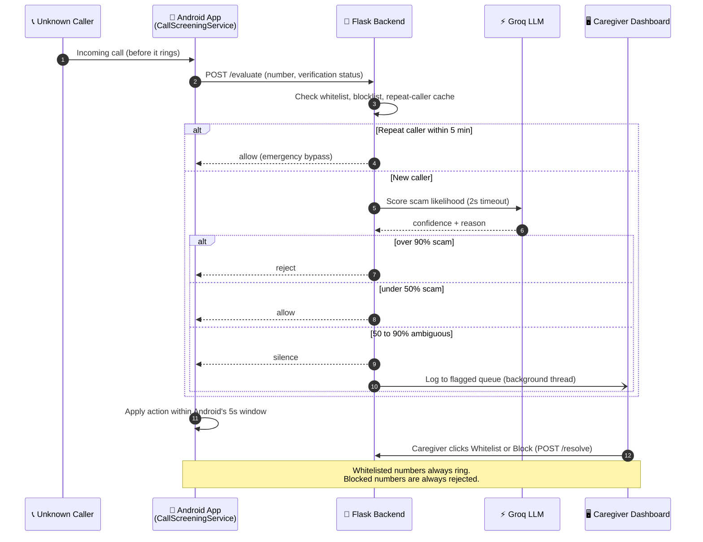
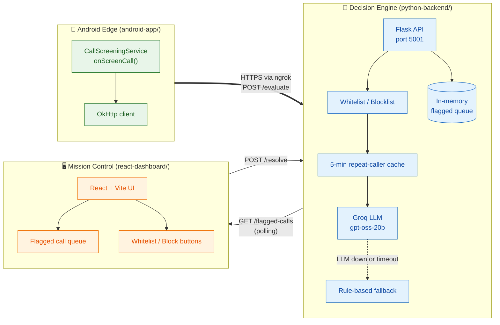
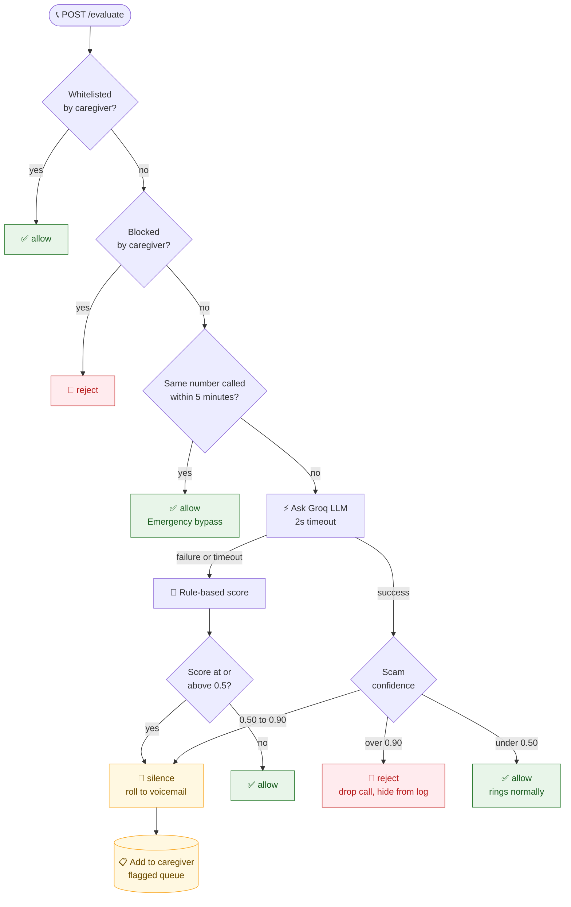
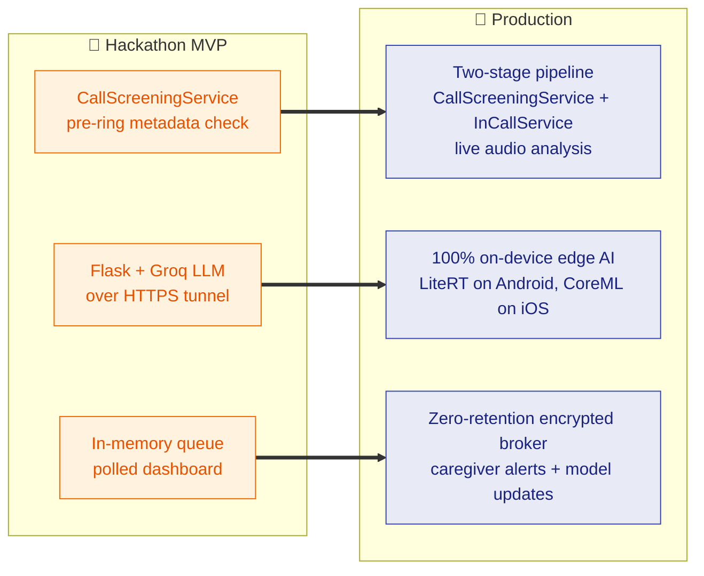

<div align="center">

# 🛡️ KinGuard

Eric, Luke, Mukunth

### Zero-UI, on-device scam call interception with a delegated caregiver network.

*The vulnerable user never has to make the security decision. A trusted family member does.*


</div>

---

## 📖 Table of Contents

- [The Problem](#-the-problem)
- [The Solution](#-the-solution)
- [How It Works](#-how-it-works)
- [Architecture](#-architecture)
- [Decision Logic](#-decision-logic)
- [Repository Layout](#-repository-layout)
- [API Reference](#-api-reference)
- [Quick Start](#-quick-start)
- [Live Demo Script](#-live-demo-script)
- [Project Status](#-project-status)
- [Roadmap](#-roadmap)
- [Team](#-team)

---

## 🚨 The Problem

Elder fraud is surging, and most of it starts with an unsolicited phone call. Attackers use high-pressure social engineering, tech-support fraud, and AI voice cloning ("grandparent scams") to pressure older adults into sending money.

Existing tools like Truecaller, Hiya, and Google Call Screen fall short for two reasons:

| Failure | Why it matters |
|---|---|
| **Static database failure** | Blocklists and STIR/SHAKEN only tell you where a call came from, not what the caller wants. Scammers spoof fresh numbers constantly. |
| **Cognitive overload** | Live-transcript screeners show a high-stress manipulation attempt on the user's screen and ask them to judge it in real time. That is exactly the fight the user is least equipped to win. |

## 💡 The Solution

KinGuard **removes the vulnerable user from the security loop entirely.**

Unknown calls are screened *before the phone rings*. Clear threats are dropped silently. Ambiguous calls are muted and sent to a **web dashboard run by a trusted caregiver**, who can whitelist or block the number with one click.

| Persona | Experience |
|---|---|
| 👵 **Protected User** | Zero UI. One-time permission setup, then invisible. Known contacts ring normally, threats never wake the screen. |
| 🧑‍💻 **Caregiver** | A "Mission Control" web dashboard with a queue of flagged calls, AI reasoning, and one-click **Whitelist** / **Block**. |

---

## ⚙️ How It Works



---

## 🏗️ Architecture

Three decoupled services in one monorepo, connected over an **ngrok** tunnel so a real phone or emulator can reach the laptop-hosted backend.



---

## 🧭 Decision Logic

Every call from an unknown number goes through the same pipeline. Order matters: cheap deterministic checks run first, and the LLM runs last.



| Confidence | Action | Android behavior |
|---|---|---|
| **> 0.90** | `reject` | Call is dropped, skipped from the call log, no notification |
| **0.50 – 0.90** | `silence` | Ringer suppressed, call rolls to voicemail, caregiver alerted |
| **< 0.50** | `allow` | Rings normally |

**Safety rails**

- ⏱️ **Fast:** the LLM call has a ~2s timeout. Android must answer within 5s total.
- 🛟 **Never fails closed on the user:** any LLM error falls back to a rule-based score. `/evaluate` never returns a 500.
- 🔁 **Emergency bypass:** a hospital or family member who redials within 5 minutes always gets through, while robocallers move on.
- 👨‍👩‍👧 **Human override:** the caregiver can whitelist a legitimate number (like a doctor) in one click.

---

## 📁 Repository Layout

```
Call-blocker/
├── android-app/        # Kotlin. CallScreeningService + OkHttp client
├── python-backend/     # Flask API, Groq integration, tests
│   ├── app.py
│   ├── requirements.txt
│   ├── .env.example
│   └── test_evaluate.py
├── react-dashboard/    # React + Vite + Tailwind caregiver UI
└── README.md
```

---

## 🔌 API Reference

Base URL: `http://localhost:5001` locally, or your `https://<id>.ngrok-free.app` tunnel.

> When calling through a free ngrok tunnel, send the header `ngrok-skip-browser-warning: true` on every request.

### `GET /health`

Liveness check. Also reports whether the LLM key is loaded.

```json
{ "status": "ok", "llm_configured": true, "model": "openai/gpt-oss-20b" }
```

### `POST /evaluate`

Called by the Android app for each unknown incoming call.

**Request**
```json
{
  "caller_id": "+15550198372",
  "verification_status": "FAILED",
  "call_direction": "INCOMING",
  "timestamp": 1761916800
}
```

**Response `200`**
```json
{
  "action": "silence",
  "confidence_score": 0.8,
  "reason": "Spoofed number, verification failed"
}
```

| `action` | Android call result |
|---|---|
| `reject` | `setDisallowCall`, `setRejectCall`, `setSkipCallLog`, `setSkipNotification` |
| `silence` | `setSilenceCall(true)` |
| `allow` | Default passthrough, phone rings |

### `GET /flagged-calls`

Returns calls awaiting caregiver review, newest first. The dashboard polls this every few seconds.

```json
[
  {
    "id": 1,
    "caller_id": "+15550198372",
    "confidence_score": 0.8,
    "reason": "Spoofed number, verification failed",
    "status": "pending",
    "timestamp": 1761916800
  }
]
```

`status` is `pending`, `whitelisted`, or `blocked`. Dashboards should show only `pending` items. `confidence_score` is 0 to 1, so multiply by 100 for a percentage.

### `POST /resolve`

Caregiver decision from the dashboard.

```json
{ "id": 1, "resolution": "whitelist" }
```

`resolution` is `"whitelist"` or `"block"`. Use the backend's integer `id` as-is. Returns `400` for bad input and `404` for an unknown id.

---

## 🚀 Quick Start

### Prerequisites

- Python 3.9+
- Node 18+ and npm (for the dashboard)
- Android Studio (for the app and emulator)
- A free [Groq API key](https://console.groq.com)
- A free [ngrok](https://ngrok.com) account

### 1. Clone

```bash
git clone https://github.com/ieatpiYT/Call-blocker.git
cd Call-blocker
```

### 2. Backend

```bash
cd python-backend
python3 -m venv venv
source venv/bin/activate
pip install -r requirements.txt

cp .env.example .env
# open .env and set GROQ_API_KEY=gsk_...   (never commit this file)

python app.py
```

Check it works: open `http://localhost:5001/health`. You want `"llm_configured": true`.

> **macOS note:** port 5000 is taken by AirPlay Receiver, which is why the backend defaults to **5001**.

Quick test:

```bash
curl -X POST http://localhost:5001/evaluate \
  -H "Content-Type: application/json" \
  -d '{"caller_id":"+15550198372","verification_status":"FAILED","call_direction":"INCOMING","timestamp":1761916800}'
```

Run the test suite:

```bash
python test_evaluate.py
```

### 3. Expose the backend with ngrok

In a **separate terminal**:

```bash
ngrok config add-authtoken <your-token>   # one time only
ngrok http 5001
```

Copy the `https://...ngrok-free.app` URL. This is the base URL the Android app and the dashboard use. Free ngrok URLs change every restart, so tell the team when it does.

### 4. Dashboard

```bash
cd react-dashboard
npm install
npm run dev
```

Point it at your ngrok URL (see the dashboard's API URL setting).

### 5. Android app

1. Open `android-app/` in Android Studio.
2. Set the backend base URL to your ngrok `https` URL.
3. Run on an emulator, grant the call-screening role when prompted, and simulate calls from the emulator's **Extended Controls → Phone** panel.

---

## 🎬 Live Demo Script

| Part | What we do | What you should see |
|---|---|---|
| **1. Zero-UI intercept** | Simulate a call from an unlisted number (`555-019-8372`) in the emulator | Phone stays silent and dark. A flagged-call card appears on the caregiver dashboard. |
| **2. Emergency bypass** | Call again from the same number within 5 minutes | The phone rings normally. The repeat-caller bypass fired. |
| **3. Caregiver override** | Click **Whitelist** on the flagged card | That number now always rings. **Block** would always reject it. |
| **4. Audio threat engine** *(planned)* | Play a recorded scam clip into the audio endpoint | Dashboard shows the transcript and a critical-threat badge with reasoning. |

> Restart the backend between rehearsals. The 5-minute cache would otherwise skip straight to the bypass on a second run.

---

## 📊 Project Status

| Component | State |
|---|---|
| ✅ Flask `/evaluate` with LLM scoring and rule-based fallback | Done |
| ✅ 5-minute emergency bypass | Done |
| ✅ `/flagged-calls` and `/resolve` | Done |
| ✅ Automated tests for the backend | Done |
| 🚧 Android `CallScreeningService` + networking | In progress |
| 🚧 Dashboard wired to live backend (currently mock data) | In progress |
| 📝 `/analyze-audio` demo endpoint (transcript + threat badge) | Planned |

---

## 🗺️ Roadmap

The hackathon MVP sends call metadata to a cloud LLM. The production design moves all inference onto the phone so no call data leaves the device.



Planned next steps:

- [ ] Voicemail and live-audio analysis (transcription plus fraud scoring)
- [ ] Contact passthrough: calls from saved contacts bypass screening entirely
- [ ] Institutional whitelist for pharmacies, healthcare, and banks
- [ ] On-device models for Android and iOS
- [ ] Persistent storage and caregiver accounts instead of in-memory state

---

## 👥 Team

| Name | Owns |
|---|---|
| **Luke** | `android-app/`, the call-screening service and network client |
| **Eric** | `python-backend/`, the decision engine, LLM integration, and integration glue |
| **Mukunth** | `react-dashboard/`, the caregiver Mission Control UI |

---

<div align="center">

**Built at a hackathon. Protecting the people who are hardest to protect.**

</div>
